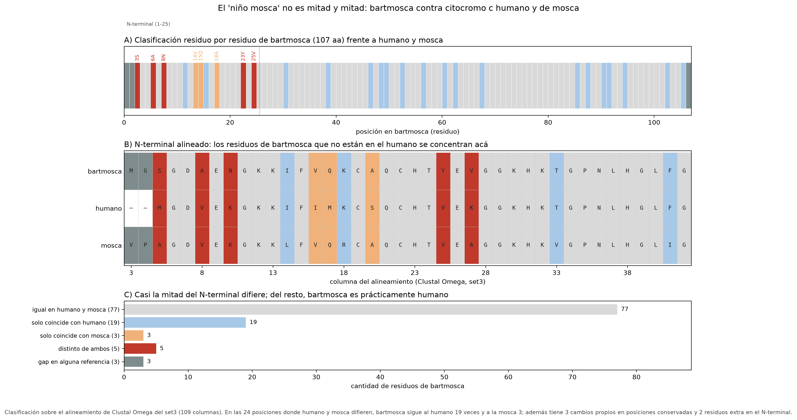

# Desafío I — ¿Cuánto del niño es mosca?

El enunciado es simpático, pero la pregunta de fondo es concreta: dadas tres secuencias —citocromo c humano, de *Drosophila melanogaster* y del "moscahumano"—, ¿cómo decido a quién se parece más la criatura, y con qué criterio sostengo esa afirmación?

Antes de tirar números, una aclaración sobre el marcador. El enunciado dice que se secuenció el *Cyt P450*, pero el archivo de secuencias que acompaña el TP (`SecuenciasCytocromoC.fasta`) y la propia secuencia de bartmosca son **citocromo c**: los encabezados son NP_061820.1 *cytochrome c* [*Homo sapiens*] y NP_001285984.1 *cytochrome c proximal, isoform B* [*Drosophila melanogaster*]. No cambia el ejercicio —se compara una proteína de la cadena respiratoria, codificada en el núcleo y muy conservada—, pero sí cambia la interpretación: no estamos mirando una enzima detoxificadora de la familia P450, sino una proteína de la cadena respiratoria. Lo aclaro porque en cualquier informe la identificación del marcador va antes que la inferencia, y porque el nombre del archivo ("CytocromoC") ya lo delataba.

## Qué haría para responderle a los padres

Ordenado de lo más informativo a lo más accesorio:

1. **Identificar la secuencia problema.** Un BLASTp contra nr (o UniProt/Swiss-Prot) dice a qué proteína y a qué organismo corresponde. En este TP el paso ya viene resuelto por los encabezados de las secuencias, así que no hace falta correrlo; en un caso real, es lo primero que haría.
2. **Alinear las secuencias y fijar la homología posicional.** Sin alineamiento no hay comparación sitio a sitio posible. Usé Clustal Omega (el que pide el TP) y MAFFT como control (Detalle en el [Desafío II](informe_desafio_II.md)).
3. **Medir distancias entre pares.** Identidad, similitud, p-distancia y su corrección por múltiples sustituciones. Es rápido y da la primera respuesta gruesa.
4. **Comparar sitio por sitio.** Un porcentaje global puede esconder que las diferencias se concentren en un bloque: motivos conservados, posiciones diagnósticas (las que distinguen humano de mosca) y residuos que no coinciden con ninguno de los dos.
5. **Buscar estructura de mosaico.** Ventanas deslizantes y clasificación residuo por residuo. Esto es lo que permite decir "es humano, salvo un tramo" en lugar de "es intermedio".
6. **Poner la secuencia en una filogenia** con otros ortólogos. El árbol dice dónde cae bartmosca respecto de los demás, y los outgroups permiten enraizar y calibrar qué significa "muy parecido" en este marcador (resultado en el [Desafío III](informe_desafio_III.md)).
7. **Control y escepticismo.** Verificar que la secuencia no tenga stops internos, longitud coherente, y que la diferencia no sea un artefacto de alineamiento. Y, sobre todo, no confundir una comparación de ~105 aminoácidos de un solo gen con una prueba de parentesco.

## Criterios para comparar las secuencias

Cada criterio responde una pregunta distinta; no hay que mezclarlos:

| Criterio | Qué mide | Qué pregunta responde | Limitación |
|---|---|---|---|
| **% identidad** | posiciones iguales sobre posiciones comparables | ¿cuánto se parecen? | depende de cómo se tratan los gaps |
| **% similitud** (BLOSUM) | sustituciones conservativas además de identidades | ¿el cambio es químico o solo de letra? | matriz elegida y gaps |
| **p-distancia** (1 − identidad) | proporción de sitios distintos | distancia cruda para comparar pares | subestima cambios múltiples en el mismo sitio |
| **distancia corregida** (p. ej. Poisson) | cambios por sitio corregidos por hits múltiples | distancia comparable con secuencias lejanas | modelo simple; se dispara cerca de la saturación |
| **conservación sitio a sitio** | residuos y motivos que no cambian | ¿se mantiene la estructura/función? | no distingue convergencia de ascendencia |
| **posiciones diagnósticas** | sitios donde humano y mosca difieren | ¿a quién sigue bartmosca en cada punto? | requiere que el alineamiento sea correcto |
| **ventanas / mosaico** | identidad local a lo largo de la secuencia | ¿hay tramos de distinto origen? | tamaño de ventana arbitrario |
| **filogenia** | topología y longitudes de rama | ¿dónde se ubica respecto de los ortólogos? | depende del modelo y del muestreo de taxones |

Dos decisiones metodológicas que hay que explicitar porque cambian los números:

- **Cómo se tratan los gaps.** La identidad que uso es *sobre posiciones comparables* (deleción de pares): se cuentan solo las columnas donde ambas secuencias tienen residuo. Si se cuentan los gaps como diferencias, el valor baja (89% en lugar de 92,4% para bartmosca–humano). El primer número es el estándar; el segundo es una cota inferior útil para comparar con la literatura.
- **Distancia cruda vs corregida.** La p-distancia sirve para pares cercanos. Cuando la divergencia crece (rhizobium–humano: p = 0,465), hay sitios que cambiaron más de una vez y la p-distancia subestima la distancia real: la corrección de Poisson da 0,63 para ese par. Con bartmosca–humano (p = 0,076) la corrección casi no mueve la aguja (0,079), así que la conclusión no depende de ese ajuste.

## Resultados

### Distancias entre pares

Sobre el alineamiento de Clustal Omega del set de tres secuencias (109 columnas):

| Par | Identidad (posiciones comparables) | p-distancia | Identidad con MAFFT |
|---|---|---|---|
| **bartmosca – humano** | **92,4%** (97/105) | 0,076 | 92,4% |
| bartmosca – mosca | 75,5% (80/106) | 0,245 | 77,4% |
| humano – mosca | 76,9% (80/104) | 0,231 | 76,9% |

La lectura directa: bartmosca está **más cerca del humano que la propia mosca**. La distancia bartmosca–humano (0,076) es un tercio de la distancia humano–mosca (0,231). Y el resultado no depende del alineador: con MAFFT los tres valores se mueven menos de dos puntos porcentuales (la comparación entre alineadores está en el [Desafío II](informe_desafio_II.md)).

### El N-terminal es lo único distinto

El porcentaje global esconde lo más interesante. Clasificando cada uno de los 107 residuos de bartmosca según a quién coincide:

| Clase | Residuos | Comentario |
|---|---|---|
| Igual en humano y mosca | 77 | el núcleo conservado del citocromo c |
| Solo coincide con humano | 19 | son las posiciones donde humano y mosca difieren |
| Solo coincide con mosca | **3** | V14, Q15 y A18 |
| Distinto de ambos | 5 | S3, A6, N8, Y23 y V25 |
| Gap en la referencia | 3 | 2 residuos extra en el N-terminal (frente a humano) y 1 gap en mosca |

Hay **24 posiciones donde humano y mosca tienen residuos distintos**. En esas posiciones bartmosca sigue al humano **19 veces**, a la mosca **3 veces** y no coincide con ninguno **2 veces** (S3 y V25). Además tiene 3 cambios propios en posiciones que humano y mosca comparten (A6, N8 y Y23), más 2 residuos extra al inicio. Total: 8 sustituciones y 2 residuos insertados respecto del humano.

El patrón espacial es contundente: **desde el residuo 26 hasta el final (82 de 107 posiciones) bartmosca es idéntico al humano al 100%**. Todas las diferencias están en los primeros 25 residuos. Ahí la identidad baja a 60% contra humano y 64% contra mosca: el N-terminal no es ni humano ni de mosca, es un tramo propio con tres residuos que coinciden con la mosca.

Si se cuenta solo sobre posiciones comparables del N-terminal, la identidad de esa región es 65% contra humano (15/23 columnas: bartmosca tiene 2 residuos extra que no se comparan) y 64% contra mosca (16/25 columnas). La diferencia con el 60% de arriba es únicamente el denominador de la comparación con humano. En cualquier caso, la conclusión no cambia: el N-terminal es la única zona con ambigüedad.

El análisis de ventanas deslizantes de 15 aminoácidos (paso 5) da lo mismo: de 22 ventanas con datos, 19 son más parecidas al humano que a la mosca; las 3 excepciones están todas en el tramo de columnas 26–50 del alineamiento, donde el N-terminal todavía pesa. La tabla completa está en [`resultados/bartmosca_ventanas.csv`](resultados/bartmosca_ventanas.csv) y la figura en [`resultados/fig_ventanas_bartmosca.png`](resultados/fig_ventanas_bartmosca.png).

### ¿Entonces cuánto del niño es mosca?

Con este marcador: **3 residuos de 107** (2,8%) son específicamente de mosca, y están todos en el N-terminal. El resto de la proteína es humano, incluidos los 19 sitios donde había que elegir entre humano y mosca y bartmosca eligió humano. Un "híbrido" de verdad debería repartir aproximadamente la mitad de las posiciones diagnósticas para cada lado; acá el reparto es 19 a 3.

Lo que el análisis no dice: los 2 residuos extra y la ubicación exacta de los gaps en el N-terminal son ambiguos. En un extremo como `MGSGDAENG…` frente a `MGDVEKG…`, el alineador puede correr los gaps sin cambiar la composición total de residuos. Esa ambigüedad afecta el conteo fino de diferencias, no la conclusión: la parte conservada es idéntica al humano y el N-terminal no coincide exactamente con ninguna de las dos referencias.

## ¿Qué resultado esperaría si usara el resto de las secuencias?

Esperaría **lo mismo, pero mejor contextualizado**: bartmosca agrupada con el humano, y el árbol enraizado por un outgroup. Las razones:

1. **La relación local no depende de los taxones lejanos.** Agregar plantas, un alga y una bacteria no cambia el hecho de que bartmosca y humano comparten 92,4% de identidad: solo agrega ramas profundas. Lo que sí cambia es la escala: la p-distancia humano–cebada es 0,38 y humano–rhizobium 0,47, contra 0,076 de bartmosca–humano. El parecido de bartmosca con el humano es de otro orden.
2. **Los outgroups permiten enraizar.** Un árbol de tres metazoos no se puede enraizar por outgroup, y sin raíz no se puede hablar de ancestro-descendiente. Con rhizobium (bacteria) como outgroup el árbol queda con una raíz defendible; ectocarpus (alga parda) queda dentro del ingroup, como hermano de las plantas verdes y con soporte bajo, así que no aporta al enraizamiento (detalle en el [Desafío III](informe_desafio_III.md)).
3. **Se gana robustez, no resolución milagrosa.** Con 131 columnas y 44 sitios parsimonia-informativos, los nodos profundos quedan con soporte bajo (el clado de plantas verdes tiene UFBoot 45). Más taxones no reemplazan más sitios informativos: para resolver el esqueleto haría falta un gen más largo, varios genes o genomas completos.

También esperaría un efecto secundario: el alineamiento de 9 secuencias tiene 131 columnas y 178 gaps, contra 109 columnas y 7 gaps del set de tres. Cuanto más divergentes las secuencias, más ambigüedad de alineamiento, y esa ambigüedad se propaga a distancias (bartmosca–mosca pasa de 75,5% a 77,4% según el alineador) y a soportes. Es el trade-off clásico: sumar taxones da contexto filogenético pero degrada la calidad del alineamiento en las zonas variables.

## Lo que le diría a los padres

- Con el marcador secuenciado, **el niño es humano**: 92,4% de identidad con el citocromo c humano y 100% idéntico en los últimos 82 residuos. La parte "mosca" son 3 residuos del extremo N-terminal, en una región que ni siquiera coincide con la mosca de referencia.
- **Un solo gen de 105–107 aminoácidos no alcanza para afirmar que hay dos especies en un mismo individuo.** Citocromo c es de las proteínas más conservadas que existen; sirve para ubicar linajes a escala de cientos de millones de años, no para detectar hibridación reciente.
- Si el caso fuera real, lo que habría que hacer es otra cosa: genoma completo o panel de SNPs del niño y de los supuestos padres, genoma mitocondrial (que se hereda solo por vía materna), y análisis de mezcla (admixture). Recién ahí se puede discutir un origen híbrido.
- La versión televisiva del "moscahumano" no está respaldada por esta secuencia. Lo que hay es un citocromo c humano con un N-terminal raro.

## Referencias

- Bromham, L. 2009. Why do species vary in their rate of molecular evolution? *Biology Letters* 5(3): 401–404.
- Iantorno, S., Gori, K., Goldman, N., Gil, M. y Dessimoz, C. 2014. Who watches the watchmen? An appraisal of benchmarks for multiple sequence alignment. *Methods in Molecular Biology* 1079: 59–73.
- Kalyaanamoorthy, S., Minh, B.Q., Wong, T.K.F., von Haeseler, A. y Jermiin, L.S. 2017. ModelFinder: fast model selection for accurate phylogenetic estimates. *Nature Methods* 14(6): 587–589.
- Nei, M. y Kumar, S. 2000. *Molecular Evolution and Phylogenetics*. Oxford University Press. (definiciones de p-distancia y corrección de Poisson)
- Sievers, F. *et al.* 2011. Fast, scalable generation of high-quality protein multiple sequence alignments using Clustal Omega. *Molecular Systems Biology* 7: 539.
- Thompson, J.D., Higgins, D.G. y Gibson, T.J. 1994. CLUSTAL W: improving the sensitivity of progressive multiple sequence alignment through sequence weighting, position-specific gap penalties and weight matrix choice. *Nucleic Acids Research* 22(22): 4673–4680.
