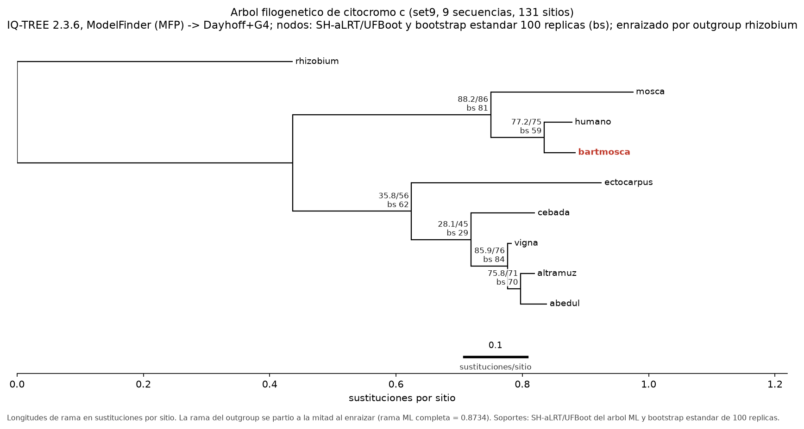
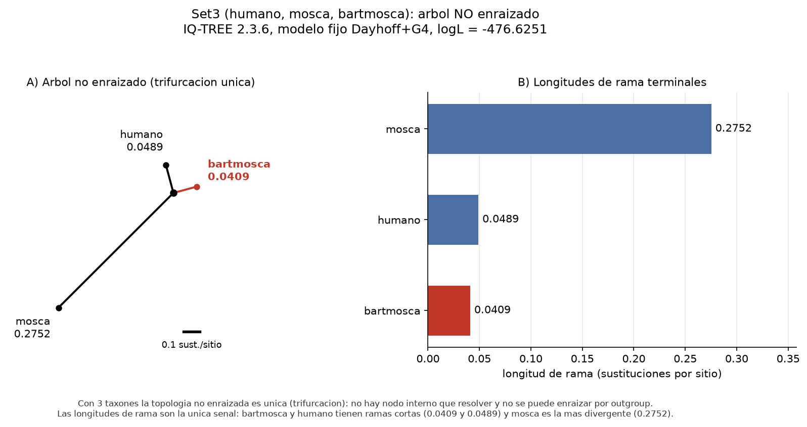

# Desafío III — Árboles, modelos y bootstrap

Acá está el núcleo metodológico del TP: cómo se pasa de un alineamiento a un árbol, qué significa el modelo de sustitución, qué mide el bootstrap y qué hay que hacer antes de interpretar el resultado.

## Qué corrí

Usé **IQ-TREE 2.3.6** local (el mismo motor del servidor web del TP, [W-IQ-TREE](http://iqtree.cibiv.univie.ac.at/)), con semilla fija para que el resultado sea reproducible. El servidor web es cómodo para una corrida, pero para dejar el análisis reproducible en un repo conviene el binario: los comandos quedan versionados y cualquiera puede repetirlos.

```bash
# Árbol principal: 9 secuencias, ModelFinder + UFBoot 1000 + SH-aLRT 1000, enraizado con rhizobium
iqtree2 -s resultados/aln_clustalo_set9.fasta -m MFP -B 1000 -alrt 1000 \
        -T 2 -o rhizobium -seed 12345 --prefix resultados/iqtree_set9 -redo

# Bootstrap estándar (100 réplicas, modelo fijo)
iqtree2 -s resultados/aln_clustalo_set9.fasta -m Dayhoff+G4 -b 100 \
        -T 2 -o rhizobium -seed 12345 --prefix resultados/iqtree_set9_boot100 -redo

# Set de 3 secuencias (modelo fijo: con 3 taxones no hay bootstrap posible)
iqtree2 -s resultados/aln_clustalo_set3.fasta -m Dayhoff+G4 -T 2 \
        -seed 12345 --prefix resultados/iqtree_set3 -redo
```

Salidas: `.treefile` (árbol ML), `.iqtree` (resumen completo), `.contree` (árbol de consenso con soportes), `.ufboot` (réplicas), y las versiones enraizada y sin enraizar en Newick ([`resultados/tree_set9_rooted.nwk`](resultados/tree_set9_rooted.nwk), [`resultados/tree_set9_unrooted.nwk`](resultados/tree_set9_unrooted.nwk)). El detalle completo de la corrida está en [`resultados/resumen_analisis.md`](resultados/resumen_analisis.md).

## El árbol



Soportes por nodo (SH-aLRT / UFBoot, y bootstrap estándar de 100 réplicas como referencia):

| Clado | SH-aLRT (%) | UFBoot (%) | Bootstrap estándar (%) | Rama (sust./sitio) |
|---|---|---|---|---|
| bartmosca + humano | 77,2 | 75,0 | 59,0 | 0,0846 |
| bartmosca + humano + mosca (Metazoa) | 88,2 | 86,0 | 81,0 | 0,3134 |
| altramuz + abedul | 75,8 | 71,0 | 70,0 | 0,0209 |
| altramuz + abedul + vigna | 85,9 | 76,0 | 84,0 | 0,0578 |
| cebada + dicotiledóneas | 28,1 | 45,0 | 29,0 | 0,0941 |
| plantas verdes + ectocarpus | 35,8 | 56,0 | 62,0 | 0,1879 |

Longitudes de rama terminales (sustituciones por sitio): **humano 0,0444**, **bartmosca 0,0497**, **mosca 0,2257**, cebada 0,1017, ectocarpus 0,3013, rhizobium 0,8734 (en el árbol sin enraizar).

Lectura:

- **bartmosca cae dentro de Metazoa y es hermana del humano**, no de la mosca. Es lo que anticipaban las distancias del [Desafío I](informe_desafio_I.md). Ojo con el soporte de ese par: SH-aLRT 77,2 / UFBoot 75 / bootstrap estándar 59, o sea que **no llega a ninguno de los tres cortes habituales** (80 / 95 / 70). Lo que sí está mejor sostenido es el clado de metazoos (88,2 / 86 / 81). La conclusión "bartmosca es humano" no se apoya en ese nodo sino en la identidad de 92,4% y en la p-distancia de 0,076.
- La rama de bartmosca (0,0497) es apenas más larga que la del humano (0,0444): unos pocos cambios extra, todos en el N-terminal. La mosca, en cambio, tiene una rama ~4,5 veces más larga (0,2257).
- Los grupos esperables se recuperan: metazoos por un lado, plantas verdes por otro, monocotiledónea (cebada) separada de las dicotiledóneas (altramuz, abedul, vigna), y la bacteria como outgroup.
- **Los nodos profundos no están resueltos.** El lugar de ectocarpus (alga parda, grupo Stramenopiles) como hermano de las plantas verdes tiene UFBoot 56 y SH-aLRT 35,8: es un nodo que el árbol no puede sostener, y lo más probable es que refleje la poca información del marcador más que una relación real. El citocromo c separa con soporte moderado algunos grupos cercanos (el trío de metazoos; altramuz–abedul–vigna entre las dicotiledóneas) y mal las separaciones profundas. Con 44 sitios informativos no hay información suficiente para el esqueleto.

### El árbol de 3 secuencias



Con tres taxones el árbol no enraizado es una **única trifurcación**: no hay ningún nodo interno que resolver y no se puede enraizar por outgroup (los tres son metazoos). IQ-TREE directamente se niega a hacer bootstrap (`It makes no sense to perform bootstrap with less than 4 sequences`). La única información está en las longitudes de rama: bartmosca 0,0409, humano 0,0489, mosca 0,2752. O sea que el árbol de tres secuencias, por sí solo, no agrega nada que no estuviera en la tabla de distancias. De ahí la pregunta del Desafío I sobre usar el resto de las secuencias: la filogenia empieza a decir algo cuando hay más taxones y un outgroup.

## ¿A qué se refiere el modelo de sustitución?

Un modelo de sustitución describe **cómo cambian los caracteres a lo largo del tiempo**: qué probabilidad hay de que un residuo pase a otro, y cómo varía esa probabilidad entre sitios y entre ramas. En proteínas se usan matrices de intercambio empíricas, estimadas de alineamientos reales: Dayhoff, JTT, WAG, LG, DCMut, etc. Son matrices 20×20 de tasas relativas de cambio entre aminoácidos.

Sobre esa base se agregan componentes:

- **Frecuencias de equilibrio** (`+F`): composición de aminoácidos observada o estimada en vez de la del modelo base. Importa cuando la composición está sesgada.
- **Heterogeneidad de tasas entre sitios** (`+G`): no todos los sitios evolucionan igual. El modelo gamma con 4 categorías (`+G4`) asigna a cada sitio una tasa tomada de una distribución gamma; el parámetro de forma `alpha` mide cuánta heterogeneidad hay (alpha chico = mucha heterogeneidad). También existe `+I` (proporción de sitios invariables) y `+R` (modelo de tasas libres).
- **Proporción de sitios invariables** (`+I`) y combinaciones (`+I+G4`).

**ModelFinder** (Kalyaanamoorthy *et al.* 2017) prueba cientos de combinaciones y elige la mejor según el criterio de información bayesiano (BIC), que premia ajuste pero penaliza parámetros.

En esta corrida ModelFinder probó hasta 1232 combinaciones y eligió **Dayhoff+G4** (BIC = 2375,92; log-likelihood = −1148,96; alpha = 1,153). El segundo puesto fue DCMut+G4 (BIC 2376,06, prácticamente empatado), y el peso BIC se reparte 0,41 contra 0,39 entre los dos. Es decir: **la elección del modelo no está fuertemente definida** con este tamaño de datos, y eso es una advertencia metodológica, no un detalle. Con 131 columnas y 44 sitios informativos, las diferencias de BIC entre matrices son chicas. No di por sentada la estabilidad: corrí también el árbol con DCMut+G4 ([`resultados/iqtree_set9_dcmut.treefile`](resultados/iqtree_set9_dcmut.treefile)) y la topología es idéntica (los mismos clados) con largos de rama casi iguales (humano 0,0443; bartmosca 0,0496; mosca 0,2255). Lo que puede moverse son los soportes y los decimales de las ramas.

El modelo no solo cambia los números: también se interpreta. `+G4` dice que hay sitios más conservados (el núcleo del citocromo c) y sitios más libres (el N-terminal), que es justamente el patrón que vimos en el Desafío I.

## ¿Qué es el bootstrap y de qué manera habla de la calidad del árbol?

El bootstrap no paramétrico (Felsenstein 1985) responde a la pregunta: *si tuviera otros tantos sitios, ¿volvería a salir este mismo clado?* El procedimiento es:

1. A partir del alineamiento original, se generan `B` alineamientos nuevos remuestreando **columnas con reemplazo** (mismo largo, algunas columnas repetidas, otras ausentes).
2. A cada réplica se le reconstruye el árbol con el mismo método.
3. El **soporte bootstrap** de un clado es la fracción de réplicas en las que ese clado aparece.

Un soporte de 100% significa que el clado aparece en todas las réplicas; 50% es indistinguible del azar. El bootstrap **no** valida el alineamiento ni el modelo: mide únicamente la estabilidad del clado frente al remuestreo de sitios. Un clado puede tener 100% de soporte y estar mal si el alineamiento está mal.

Hay tres números distintos que suelen confundirse y que en este trabajo aparecen juntos:

- **Bootstrap estándar** (`-b`): el procedimiento descrito arriba, con reconstrucción completa en cada réplica. Es lento. Umbral habitual: ≥ 70% se considera soporte razonable.
- **UFBoot** (`-B`): una aproximación ultrarrápida (Minh *et al.* 2013; Hoang *et al.* 2018) que evita reconstruir cada réplica. Los umbrales son otros: ≥ 95% se considera bien soportado. En IQ-TREE 2 exige al menos 1000 réplicas.
- **SH-aLRT** (`-alrt`): test de razón de verosimilitud con remuestreo; se reporta junto con UFBoot y se interpreta con umbral ≥ 80%.

**¿Cómo influye el número de réplicas?** El soporte estimado tiene un error de muestreo tipo Monte Carlo que baja como `√(p(1−p)/B)`. Con 100 réplicas el ruido es grande (del orden de ±4–5 puntos porcentuales para un soporte cercano a 50%, ±2–3 para uno cercano a 90%); con 1000 baja a un tercio (√10 ≈ 3,2 veces menos). Eso no cambia la señal, pero sí la precisión con que la reportamos. Lo medí sobre las mismas réplicas de UFBoot (submuestreando las 1000 que se guardaron):

| Nodo | UFBoot 100 (%) | UFBoot 1000 (%) | Cambio (pp) |
|---|---|---|---|
| bartmosca + humano | 78,0 | 74,5 | 3,5 |
| Metazoa (bartmosca + humano + mosca) | 84,0 | 85,1 | −1,1 |
| plantas verdes | 36,0 | 44,4 | −8,4 |
| plantas verdes + ectocarpus | 53,0 | 56,3 | −3,3 |

*(El valor de 1000 réplicas de esta tabla sale de la corrida con modelo fijo; coincide dentro de 1 punto con el del árbol principal.)*

Con 100 réplicas el soporte de un nodo con señal fuerte se mueve ~1 punto (Metazoa: 84,0 → 85,1); el de un nodo con señal débil puede moverse hasta 8 (plantas verdes: 36,0 → 44,4). **Para los nodos que importan en este TP (bartmosca + humano, Metazoa) el número de réplicas no cambia la conclusión**; para los nodos profundos, con 100 réplicas el valor es directamente inestable. En la práctica: usar 1000 réplicas (o más) cuando se reporta soporte, y no obsesionarse con el tercer decimal.

Hay una diferencia de método que vale aclarar: para el clado bartmosca + humano, UFBoot da 75% y el bootstrap estándar de 100 réplicas da 59%. No es una contradicción: los dos métodos tienen escalas distintas y el bootstrap estándar es más conservador. En ambos casos el clado aparece; la diferencia es cuánto se exige para llamarlo "bien soportado".

## Interpretar los árboles: el paso que falta antes de leerlos

**Sí, hace falta un paso previo: enraizar el árbol.** Los modelos de sustitución reversibles que se usan acá no permiten identificar la raíz, así que el árbol que devuelven es **sin raíz**: dice cómo se agrupan las secuencias, pero no en qué dirección fue la evolución. Sin raíz no se puede hablar de ancestro y descendiente, ni de "el clado de los animales" en sentido estricto. En la práctica eso significa un paso más antes de interpretar:

1. **Enraizar por outgroup**: se elige un taxón que por información externa sabemos que es más lejano (acá rhizobium, una bacteria) y se cuelga la raíz en la rama que lo conecta. Con IQ-TREE es `-o rhizobium`; en FigTree, seleccionar esa rama y usar **Tree → Reroot on Selected Branch**.
2. **Enraizamiento por punto medio** (midpoint): alternativa que no usa outgroup; coloca la raíz en el punto medio del camino más largo entre dos puntas del árbol (queda equidistante de las dos secuencias más distantes). Sirve cuando no hay un outgroup claro, pero supone un reloj molecular y puede fallar si las tasas varían mucho. En FigTree: **Tree → Midpoint Root**.
3. Las dos versiones quedaron guardadas: [`resultados/tree_set9_rooted.nwk`](resultados/tree_set9_rooted.nwk) (outgroup) y [`resultados/tree_set9_unrooted.nwk`](resultados/tree_set9_unrooted.nwk) (la salida cruda de IQ-TREE). Compararlas es útil: la topología de los clados no cambia, lo que cambia es qué nodo es la raíz.

Otros pasos antes de escribir conclusiones: mirar los **soportes** de cada nodo (no leer la topología sin ellos), verificar que la **barra de escala** esté visible y entender que las longitudes son sustituciones por sitio. Con 9 taxones y 44 sitios informativos varios nodos internos quedan mal resueltos, y el soporte es la forma de detectarlo.

*Sobre FigTree:* las figuras de este informe salieron de los mismos `.treefile` con Biopython y matplotlib, y los archivos quedan listos para abrir en FigTree (`resultados/iqtree_set9.treefile`), enraizar en la rama de rhizobium y exportar. Los pasos concretos están en [`resultados/resumen_analisis.md`](resultados/resumen_analisis.md).

## Qué dicen los resultados juntos

1. La secuencia del "moscahumano" es **hermana del citocromo c humano**, con soporte moderado (UFBoot 75 / SH-aLRT 77 / bootstrap 59, por debajo de los cortes 95/80/70). No es hermana de la mosca. La evidencia más fuerte no es ese nodo sino la identidad (92,4%) y la distancia (p = 0,076).
2. El clado de metazoos (bartmosca + humano + mosca) tiene soporte más alto (86/88; 81 de bootstrap estándar): el marcador reconoce que las tres son animales, y dentro de ellos bartmosca y humano son el par más cercano.
3. Los tres residuos de bartmosca que coinciden con la mosca (V14, Q15, A18) son cambios concentrados en el N-terminal, una región de evolución rápida. Aparecen como cambios en la rama de bartmosca; con este muestreo no se puede distinguir si son convergencias o retención de estados ancestrales, pero no son evidencia de un segundo origen.
4. Los nodos profundos del árbol (relaciones entre plantas, posición de ectocarpus) tienen soporte bajo y no deben usarse para afirmar relaciones entre linajes. Es la limitación esperable de un marcador de ~105 aminoácidos.

## Limitaciones

- **Bootstrap estándar de 1000 réplicas**: lo intenté y en esta máquina tardaba más de una hora (≈ 4 s por réplica). Lo reemplacé por 100 réplicas con modelo fijo, que es suficiente para lo que se discute acá, y por UFBoot 1000 para el árbol principal. La comparación 100 vs 1000 se hizo sobre las réplicas de UFBoot, que ya estaban guardadas.
- **IQ-TREE 2 no permite UFBoot con menos de 1000 réplicas** ni bootstrap con menos de 4 taxones. Son restricciones del programa, no del análisis; quedan documentadas para que no parezcan números faltantes.
- **Modelo**: Dayhoff+G4 y DCMut+G4 están prácticamente empatados por BIC. Corrí los dos: la topología es idéntica y las ramas casi iguales, pero no presentaría los largos como exactos al tercer decimal.
- **Un solo marcador**: todas las conclusiones valen para el citocromo c. Para inferir relaciones entre especies o un origen híbrido hace falta más evidencia (varios genes, genomas). El TP lo plantea como juego, pero el límite metodológico es real.

## Referencias

- Dayhoff, M.O., Schwartz, R.M. y Orcutt, B.C. 1978. A model of evolutionary change in proteins. En: *Atlas of Protein Sequence and Structure*, vol. 5, supl. 3, pp. 345–352.
- Felsenstein, J. 1985. Confidence limits on phylogenies: an approach using the bootstrap. *Evolution* 39(4): 783–791.
- Hoang, D.T., Chernomor, O., von Haeseler, A., Minh, B.Q. y Vinh, L.S. 2018. UFBoot2: improving the ultrafast bootstrap approximation. *Molecular Biology and Evolution* 35(2): 518–522.
- Kalyaanamoorthy, S., Minh, B.Q., Wong, T.K.F., von Haeseler, A. y Jermiin, L.S. 2017. ModelFinder: fast model selection for accurate phylogenetic estimates. *Nature Methods* 14(6): 587–589.
- Minh, B.Q., Nguyen, M.A.T. y von Haeseler, A. 2013. Ultrafast approximation for phylogenetic bootstrap. *Molecular Biology and Evolution* 30(5): 1188–1195.
- Rambaut, A. 2012. FigTree v1.4. <http://tree.bio.ed.ac.uk/software/figtree/>
- Trifinopoulos, J., Nguyen, L.T., von Haeseler, A. y Minh, B.Q. 2016. W-IQ-TREE: a fast online phylogenetic tool for maximum likelihood analysis. *Nucleic Acids Research* 44(W1): W232–W235.
